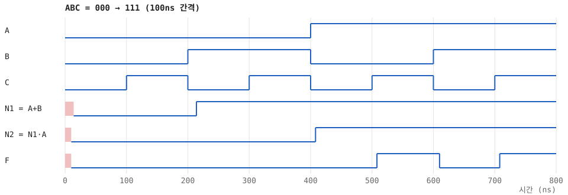
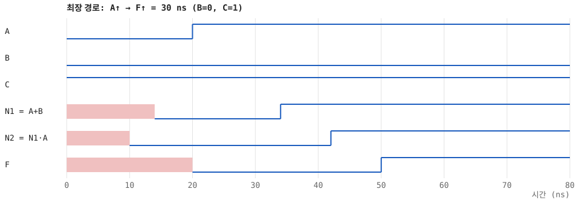
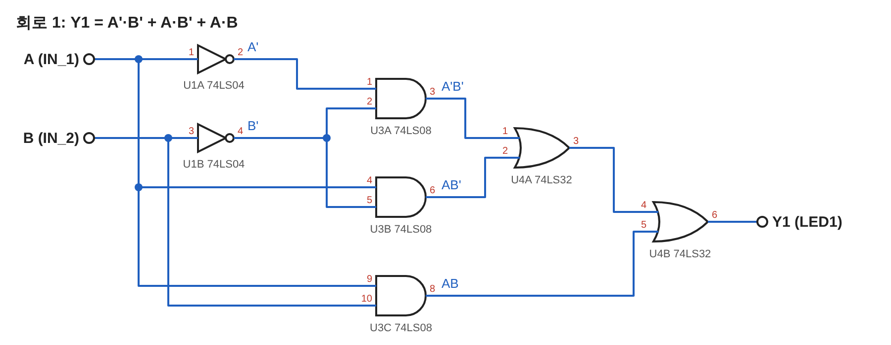
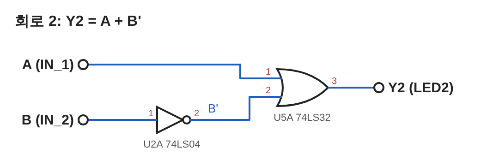
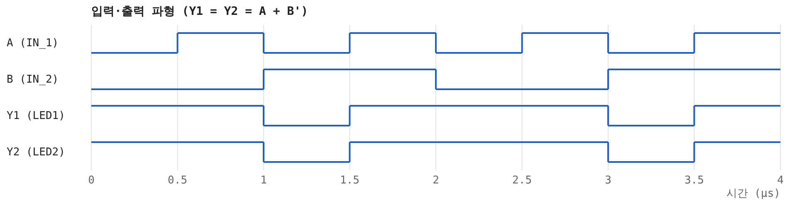
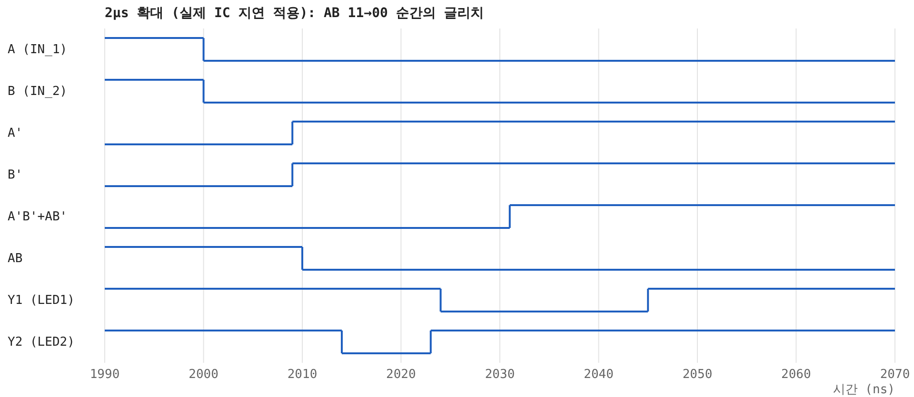
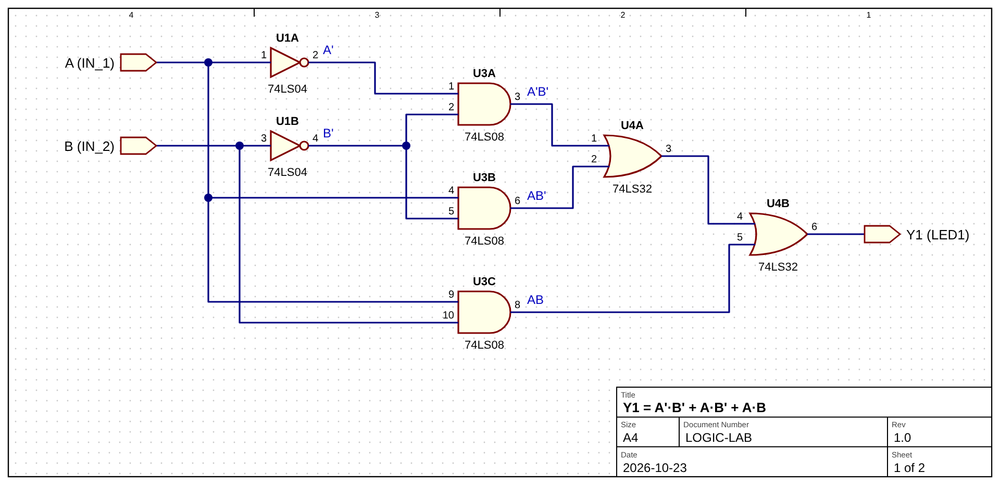
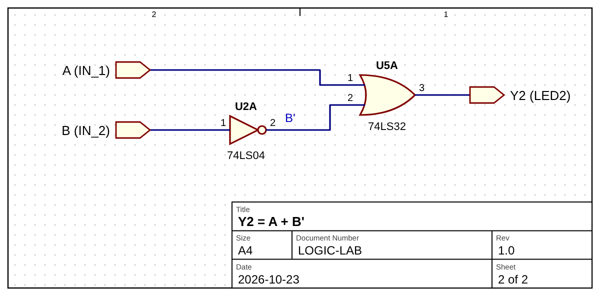
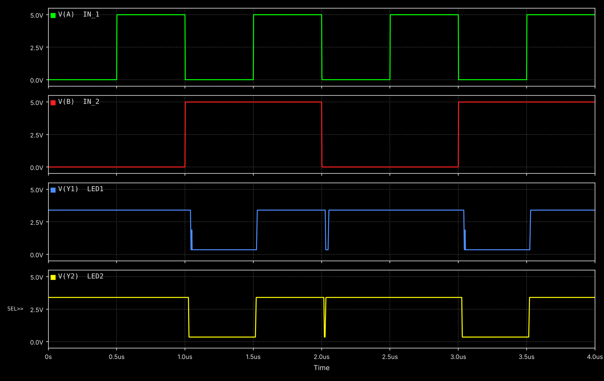
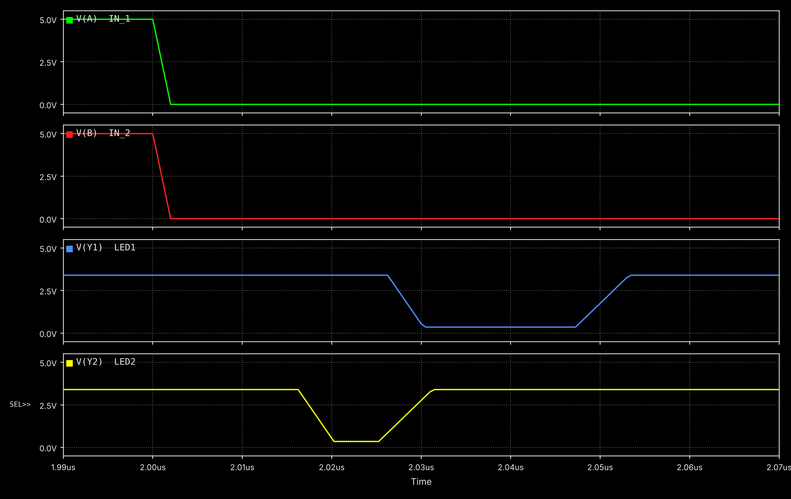

# logicsim: 74LS 논리 IC 회로 시뮬레이터

74LS08(AND), 74LS32(OR) 같은 TTL 논리 IC를 **핀 번호 그대로** 배선하고, 진리표와 **전파 지연이 반영된 타이밍 파형**을 확인하는 작은 시뮬레이터입니다.
PSpice의 디지털 소자 모델처럼 IC 내부 트랜지스터는 계산하지 않고, 핀 배치·논리 기능·전파 지연만 모델링합니다.
파이썬 표준 라이브러리만 사용합니다.

## 예제: F = (A+B)·A·C

2입력 OR 게이트 1개(74LS32)와 2입력 AND 게이트 2개(74LS08)로 구성합니다.

```
A ──┬──────────────┐
    │   ┌─────┐    │  ┌─────┐
    └───┤ OR  ├─N1─┴──┤ AND ├─N2──┐  ┌─────┐
B ──────┤ U1A │       │ U2A │     └──┤ AND ├── F
        └─────┘       └─────┘   C ───┤ U2B │
                                     └─────┘
```

### 배선표 (브레드보드에 그대로 꽂으면 됩니다)

| IC | 핀 | 연결 |
|---|---|---|
| U1 74LS32 | 14 / 7 | VCC(+5V) / GND |
| U1 74LS32 | 1, 2 → 3 | A, B → N1 |
| U2 74LS08 | 14 / 7 | VCC(+5V) / GND |
| U2 74LS08 | 1, 2 → 3 | N1, A → N2 |
| U2 74LS08 | 4, 5 → 6 | N2, C → **F** |

### 실행

```bash
python3 -m examples.and_or_f   # 진리표 출력 + 파형 SVG 생성
python3 -m unittest            # 테스트
```

### 결과: 진리표

| A | B | C | F |
|---|---|---|---|
| 0 | 0 | 0 | 0 |
| 0 | 0 | 1 | 0 |
| 0 | 1 | 0 | 0 |
| 0 | 1 | 1 | 0 |
| 1 | 0 | 0 | 0 |
| 1 | 0 | 1 | **1** |
| 1 | 1 | 0 | 0 |
| 1 | 1 | 1 | **1** |

**간소화:** 흡수 법칙 `(A+B)·A = A` 에 의해 **F = A·C** 입니다.
즉 이 회로는 AND 게이트 1개로 같은 기능을 낼 수 있고, 시뮬레이션 결과도 8가지 입력 모두에서 A·C와 일치합니다.

### 결과: 타이밍 파형

ABC를 000 → 111로 100ns마다 바꿨을 때 (분홍색 = 전원 인가 직후 알 수 없는 상태):



가장 긴 경로(B=0, C=1에서 A만 0→1): 신호가 OR → AND → AND를 차례로 지나므로
**14 + 8 + 8 = 30ns** 뒤에 F가 올라갑니다.



## 실습: Y1 = A'B' + AB' + AB 와 Y2 = A + B'

부품: 74LS04 2개, 74LS08 1개, 74LS32 2개. 입력 IN_1 = A, IN_2 = B (시작값 LOW 클럭, 주기 배수 10 / 20 → 1칸을 100ns로 가정해 1µs / 2µs).

```bash
python3 -m examples.lab_a_plus_not_b
node tools/svg_to_png.js examples/output/lab_a_plus_not_b/*.svg   # 발표용 PNG (Playwright 필요)
```

| 회로 1 | 회로 2 |
|---|---|
|  |  |

| A | B | Y1 | Y2 |
|---|---|---|---|
| 0 | 0 | 1 | 1 |
| 0 | 1 | **0** | **0** |
| 1 | 0 | 1 | 1 |
| 1 | 1 | 1 | 1 |

간소화: `A'B' + AB' + AB = B'(A' + A) + AB = B' + AB = A + B'` 이므로 두 회로는 같은 기능입니다 (게이트 7개 → 2개).



**실제 IC 지연을 넣으면:** A와 B가 동시에 바뀌는 순간(AB 11→00) 두 출력 모두 짧은 글리치(정적 해저드)가 생깁니다.
Y1은 경로가 길어 21ns, Y2는 9ns 동안 0으로 떨어지고, Y1은 AB 10→01 순간에도 7ns 글리치가 한 번 더 생깁니다.
LED로는 보이지 않을 만큼 짧지만, 이 출력을 플립플롭 클럭 등에 쓰면 오동작할 수 있습니다.



### ngspice 전압 파형 + EDA 스타일 회로도

같은 회로를 ngspice(XSPICE 디지털 게이트 모델, 74LS 대표 지연)로 돌려 실제 전압으로 그린 버전입니다.
입력은 0–5V 클럭, 출력은 TTL 레벨(LOW 0.35V, HIGH 3.4V, 상승 6ns/하강 4ns)입니다.

```bash
python3 spice/plot_waveforms.py     # ngspice, matplotlib 필요
```






## 모델링한 것

- 74xx DIP-14 핀 배치 (VCC=14, GND=7)
- 전파 지연 tPLH / tPHL (TI 데이터시트 대표값 근사: 74LS08 8/10ns, 74LS32 14/14ns)
- 0 / 1 / X(알 수 없음) 3값 논리
- 배선 검사: 전원 핀 미연결 → 오류, 출력 두 개가 한 넷에 연결 → 오류, 떠 있는 입력 → 경고(TTL은 HIGH로 읽음)

## 한계

- 전압·전류는 계산하지 않음 (논리 레벨만)
- 지연은 대표값 하나로 고정 (온도·부하·전원 전압에 따른 변화 없음)
- 지연은 전송 지연(transport delay) 방식이라 지연보다 짧은 펄스도 걸러지지 않고 그대로 전달됨

## 구조

```
logicsim/
  chips.py     IC 모델 (핀 배치, 논리 함수, 지연)
  circuit.py   이벤트 기반 시뮬레이션 엔진
  waveform.py  SVG 타이밍 다이어그램
examples/and_or_f.py   F = (A+B)·A·C 예제
tests/                 unittest
```
